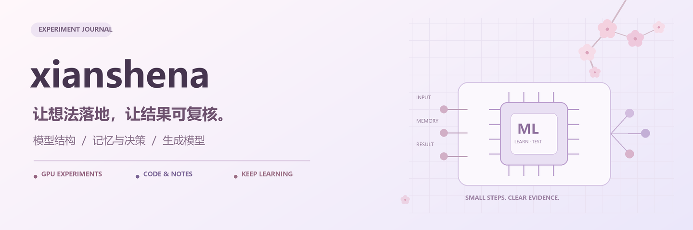

**通过实验理解模型，把成功、失败和限制一起留下。**

[GPU 实验](navigation/gpu-experiments.md) · [学习资料](navigation/learning.md) · [代码资料](navigation/code.md) · [杂谈](navigation/notes.md)

## 我的四个抽屉

| 🧪 GPU 实验 · 公开 | 📚 学习资料 · 私有 |
| --- | --- |
| [训练记录、结构对照、结果与边界 →](navigation/gpu-experiments.md) | [学习区的保存说明 →](navigation/learning.md) |
| **🧩 代码资料 · 保留各库可见性** | **🌸 杂谈 · 公开** |
| [可运行示例与源码阅读入口 →](navigation/code.md) | [技术随笔入口，整理中 →](navigation/notes.md) |

## 最近在做：MemLite

在合成场景里研究：**历史经验怎样影响下一次选择？换一个模型结构，结果会怎样变化？**

- **记忆与决策**：3.08 亿参数模型的三种子实验，含 history-swap、clear-memory 对照和逐决策审计。
- **结构与生成**：指令结构、长期事实、操作顺序，以及生成模型对照的阶段记录；不同版本和补跑分别列出。
- **从一个小例子开始**：G0/G1a 的 CPU 示例，再沿着报告读到数据和代码。

[打开中文实验目录](https://github.com/xianshena/memlite/blob/main/docs/EXPERIMENTS.zh-CN.md) · [按时间线阅读](https://github.com/xianshena/memlite/blob/main/docs/TIMELINE.zh-CN.md) · [进入 MemLite](https://github.com/xianshena/memlite)

查看实验数字与适用范围

3.08 亿是**模型参数量**，不是训练次数。生活选择的 daily subset 每种子 n=1,600，准确率分别为 94.125%、94.0625%、94.125%；不代表全部 2,000 场景的准确率。

目前结果主要来自合成、离线任务；导航使用确定性 BFS。4B 教师 / 1.85B 学生是探索附录，没有独立测试，也不继承 3.08 亿参数模型的成绩。结构实验的完成数不等于能力达标，补跑与原批次分别保留。项目仍处于早期，尚无已核验的外部使用或独立复现证据。

---

小步尝试 · 认真记录 · 持续学习 Learning through experiments, one clear record at a time.

